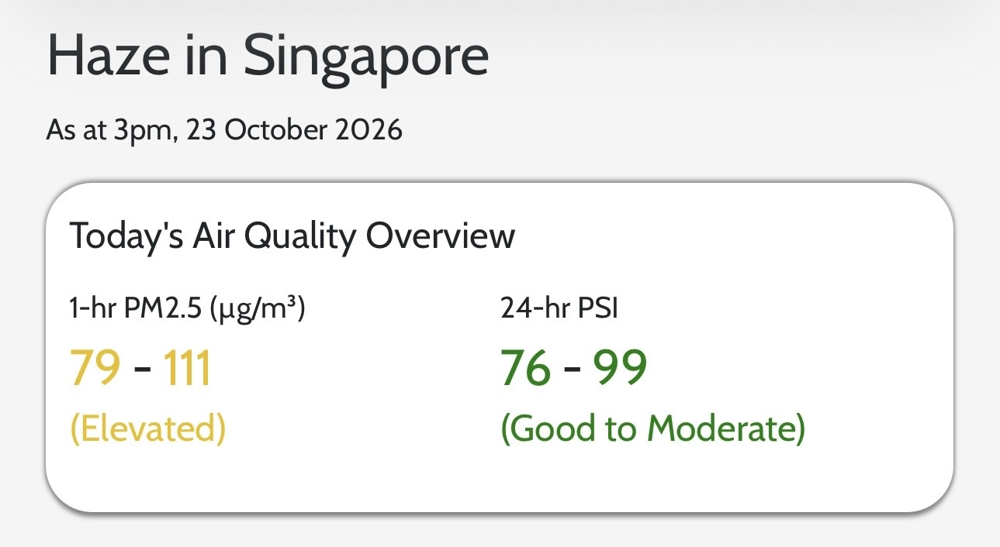
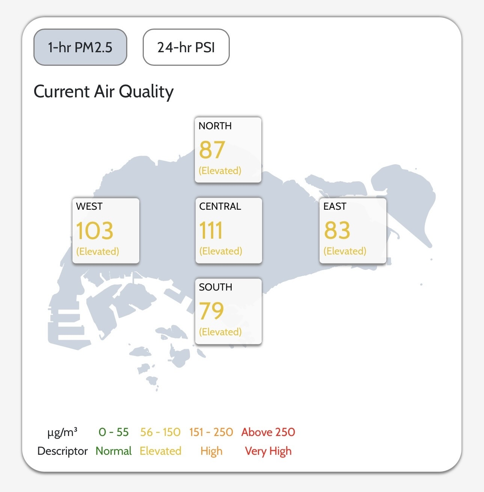
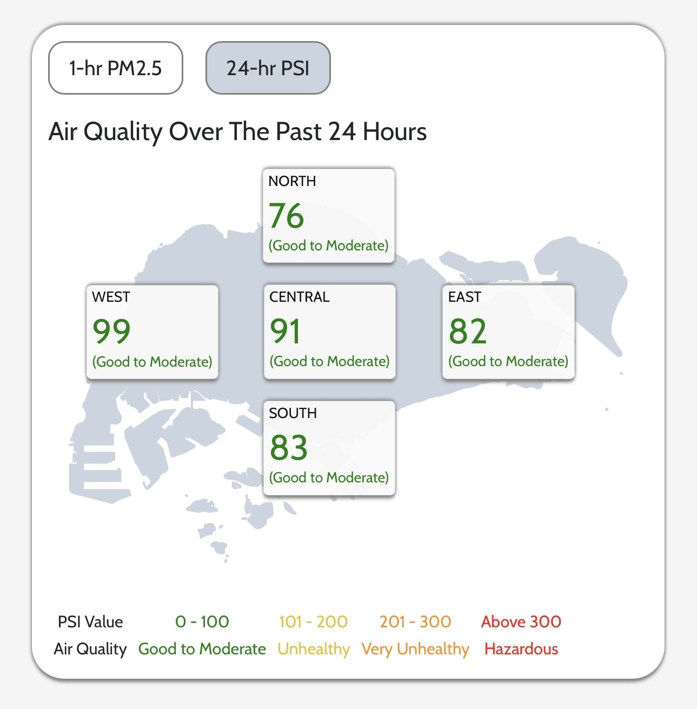
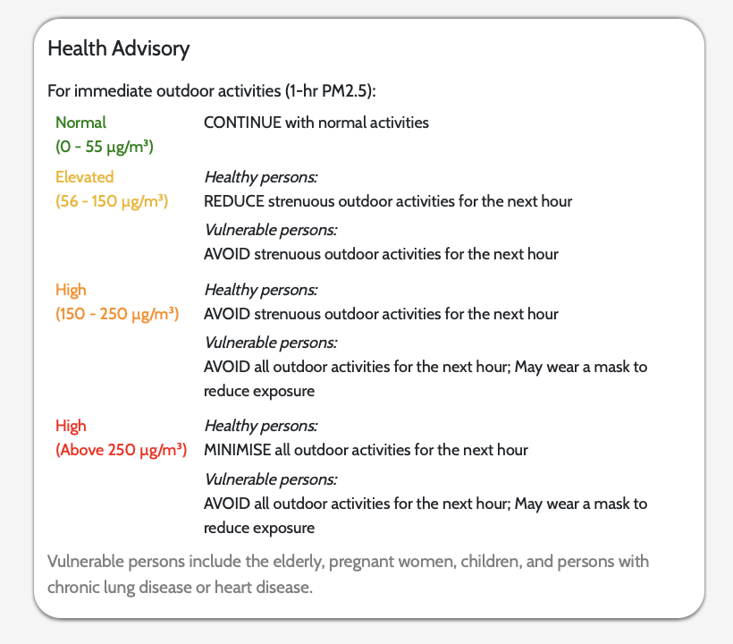

# Haze in Singapore

This application provides information on the haze situation in Singapore.

## Features
- An overview of the air quality for the day (1-hr PM2.5 and 24-hr PSI).
- Air quality readings for the five major regions in Singapore, differentiated by the colours for each band.
- A health advisory guide for immediate outdoor activities, based on the current air quality given by the 1-hr PM2.5 reading. It follows the NEA guide in October 2026.

## Usage
Access the application website via this [link](https://keithtohx.github.io/sg-haze/).

- The date and time when the air quality readings was last updated is provided at the top of the page.
- View the air quality readings at a glance with the overview:

    

- Toggle between the two buttons to view the current or past 24-hour air quality readings for each region:

    
    

- View the health advisory guide when planning for immediate outdoor activities:

    

## Tech Stack
This website was developed using HTML, CSS and JavaScript.

All data presented is retrieved from Singapore's open data portal (https://data.gov.sg).
- The following APIs were used: 
    - NEA - Pollutant Standards Index (PSI) 
    - NEA - PM2.5
- The following dataset was used:
    - URA - Master Plan 2019 Subzone Boundary (No Sea) (GEOJSON)